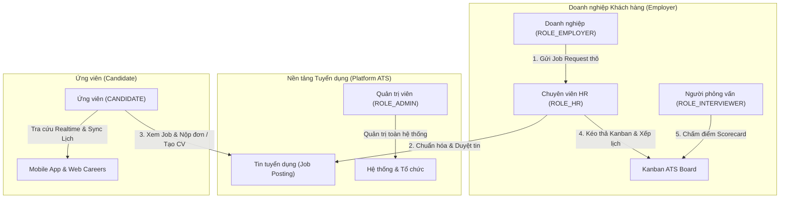
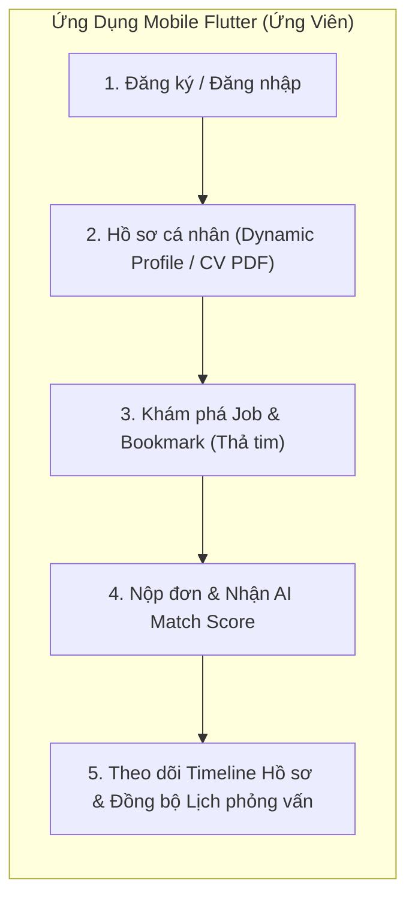

# BÁO CÁO TỔNG HỢP Ý TƯỞNG & TIẾN ĐỘ THỰC HIỆN ĐỒ ÁN
## ĐỀ TÀI: NỀN TẢNG QUẢN LÝ TUYỂN DỤNG VÀ KẾT NỐI VIỆC LÀM ĐA NỀN TẢNG (SaaS ATS & RECRUITMENT ECOSYSTEM)

---

> **Sinh viên thực hiện:** Nguyễn Minh Hùng  
> **Chuyên ngành:** Kỹ thuật Phần mềm / Công nghệ Thông tin  
> **Nền tảng phát triển:** Web Portal (Spring Boot, Thymeleaf/Tailwind) & Mobile App (Flutter Cross-Platform)  
> **Cơ sở dữ liệu:** MySQL Database  
> **Thời gian cập nhật:** Tháng 11/2026  

---

## 1. TỔNG QUAN Ý TƯỞNG & MÔ HÌNH HỆ THỐNG

### 1.1. Bối cảnh & Mục tiêu đề tài
Trong kỷ nguyên số, quy trình tuyển dụng truyền thống qua email hoặc các bảng tính rời rạc bộc lộ nhiều điểm nghẽn: thất lạc hồ sơ, phản hồi ứng viên chậm trễ, khó đo lường hiệu quả phỏng vấn và thiếu sự kết nối liền mạch giữa Doanh nghiệp - Nhà tuyển dụng - Ứng viên.

Đề tài xây dựng một **Hệ sinh thái Tuyển dụng Toàn diện (All-in-One SaaS ATS Platform)** hoạt động theo mô hình **B2B2C (Business-to-Business-to-Consumer)**:
- **B2B (Phía Doanh nghiệp & Tuyển dụng):** Cung cấp Web Portal quản trị tuyển dụng hiện đại với bảng Kanban trực quan, tự động hóa quy trình sàng lọc (Knock-out Screening), điều phối lịch phỏng vấn, chấm điểm ứng viên đa tiêu chí và tự động xuất Thư mời nhận việc (PDF Offer Letter).
- **B2C (Phía Ứng viên):** Cung cấp Cổng thông tin việc làm trực tuyến kết hợp **Trình tạo CV chuẩn TopCV đa bố cục** trên Web, cùng **Ứng dụng Di động (Flutter Mobile App)** giúp ứng viên tìm việc, nhận gợi ý độ phù hợp bằng AI (AI Match Score) và theo dõi trạng thái hồ sơ theo thời gian thực (Realtime Timeline).

---

### 1.2. Hệ thống Phân quyền (RBAC) Chuẩn hóa
Hệ thống thiết lập 4 nhóm quyền rõ ràng, bảo mật thông qua **Spring Security** kết hợp mã hóa mật khẩu **BCrypt**:

1. **`ROLE_ADMIN` (Super Admin):** Quản trị viên cao nhất của nền tảng, quản lý toàn bộ danh mục công ty đối tác, tài khoản người dùng, cấu hình tham số hệ thống và giám sát Audit Log.
2. **`ROLE_HR` (HR Platform / Recruiter):** Đội ngũ nhân sự chuyên trách của nền tảng; tiếp nhận yêu cầu tuyển dụng thô từ đối tác, biên tập thành tin chính thức, sàng lọc CV trên bảng Kanban, sắp xếp lịch phỏng vấn và phát hành Offer Letter.
3. **`ROLE_EMPLOYER` (Công ty khách hàng):** Đại diện các doanh nghiệp có nhu cầu nhân sự; tạo yêu cầu tuyển dụng sơ bộ (Job Request), theo dõi tiến độ số lượng ứng viên theo từng vị trí của riêng công ty mình.
4. **`ROLE_INTERVIEWER` (Hội đồng Phỏng vấn):** Nhân sự chuyên môn của doanh nghiệp; chỉ tiếp cận hồ sơ khi được HR phân công buổi phỏng vấn, thực hiện chấm điểm qua phiếu đánh giá (Evaluation Scorecard Pass/Fail).
5. **`CANDIDATE` (Ứng viên tìm việc):** Đăng ký/đăng nhập tự do trên Web và Mobile, tạo CV online, nộp đơn ứng tuyển và tra cứu lịch sử hồ sơ.

---

## 2. KẾT QUẢ ĐÃ HOÀN THÀNH (CURRENT ACHIEVEMENTS)

Dự án hiện đã hoàn thiện phần lớn hạ tầng cốt lõi, cơ sở dữ liệu, hai giao diện Web Portal hoàn chỉnh và khung ứng dụng Mobile:

### 2.1. Hạ tầng Backend & Cơ sở dữ liệu (Spring Boot 3 + MySQL)
- **Kiến trúc:** Xây dựng trên nền tảng **Spring Boot 3.3.1**, cấu trúc phân lớp chuẩn Enterprise: Controller, Service, Repository, Entity, DTO.
- **Cơ sở dữ liệu quan hệ MySQL:**
  - Bảng `users`: Lưu trữ thông tin tài khoản, phân quyền RBAC, phòng ban.
  - Bảng `job_postings`: Quản lý tin tuyển dụng, mức lương, yêu cầu kinh nghiệm, chỉ tiêu tuyển, hạn nộp.
  - Bảng `candidates`: Quản lý hồ sơ ứng viên, đường dẫn file CV, trạng thái vòng tuyển dụng (`NEW`, `TECH_INTERVIEW`, `HR_ROUND`, `OFFER`, `HIRED`, `REJECTED`).
  - Bảng `interview_schedules`: Quản lý lịch hẹn phỏng vấn, link meeting, hội đồng phỏng vấn.
  - Bảng `offers`: Quản lý thông tin chế độ đãi ngộ, lương gross, ngày bắt đầu làm việc, trạng thái ký duyệt.
  - Bảng `audit_logs`: Ghi nhận nhật ký truy vết bảo mật (Ai làm gì, lúc nào, từ IP nào).
- **Bảo mật:**
  - Tích hợp thư viện `spring-security-crypto` với cơ chế mã hóa mật khẩu một chiều an toàn cao **BCrypt** (`$2a$10$...`).
  - Tự động mã hóa mật khẩu khi khởi tạo tài khoản (`DataInitializer`) và tự động kiểm tra, nâng cấp các mật khẩu cũ sang chuẩn BCrypt.
  - API xác thực `/api/auth/login` và đăng ký `/api/auth/register` hoạt động độc lập, xác thực chuẩn mật khẩu đã băm.
- **Dịch vụ tệp tin & Văn bản:**
  - `FileStorageService`: Quản lý tải lên và lưu trữ an toàn các tệp CV (PDF/DOCX) trên ổ cứng máy chủ.
  - `PdfOfferService`: Tự động biên soạn Thư mời nhận việc (Offer Letter) chuẩn hóa dưới định dạng file PDF kèm con dấu, chữ ký số giả lập phục vụ ứng viên tải về.
  - `EmailNotificationService`: Gửi email phản hồi tự động cho ứng viên ngay sau khi nộp đơn và khi nhận được lịch phỏng vấn.

---

### 2.2. Web Portal 1: Cổng Quản Trị Tuyển Dụng Doanh Nghiệp (`/recruitment`)
- **Bảng Kanban ATS đa tầng (Drag & Drop Pipeline):**
  - Quản lý quy trình 5 bước trực quan: *Ứng tuyển mới $\rightarrow$ Sàng lọc hồ sơ $\rightarrow$ Phỏng vấn chuyên môn $\rightarrow$ Đề xuất nhận việc (Offer) $\rightarrow$ Tiếp nhận Onboarding*.
  - Cho phép thao tác chuyển trạng thái ứng viên mượt mà, tự động cập nhật Database và ghi nhận Audit Log.
- **Sàng lọc tự động Knock-out Screening:** Kiểm tra năm kinh nghiệm của ứng viên so với yêu cầu vị trí (`minExperienceYears`), tự động gắn nhãn loại trực tiếp nếu không thỏa điều kiện tiên quyết.
- **Trình xem CV trực tiếp (Inline CV Viewer):** Nhúng trực tiếp bản xem trước file CV PDF ngay trên trình duyệt, không bắt buộc người quản trị phải tải file về máy tính.
- **Phiếu chấm điểm phỏng vấn (Evaluation Scorecard):** Đánh giá ứng viên theo thang điểm 5 sao cho từng tiêu chí: Kiến thức kỹ thuật, Tư duy logic, Giao tiếp ứng xử, Thái độ làm việc; tự động tính điểm trung bình và đưa ra khuyến nghị Pass/Fail.
- **Quy trình Onboarding:** Quản lý danh sách giấy tờ tiếp nhận nhân sự mới (Hợp đồng, BHYT, Thiết bị cấp phát).

---

### 2.3. Web Portal 2: Cổng Thông Tin Tuyển Dụng & Trình Tạo CV Đa Bố Cục (`/careers`)
- **Thư viện 16 Mẫu CV Tiêu Chuẩn TopCV:**
  - Phân loại chuyên sâu theo 4 nhóm ngành trọng điểm: *Công nghệ thông tin (IT), Kinh doanh & Marketing, Thiết kế & Sáng tạo (UI/UX), Nhân sự & Hành chính*.
  - Phân cấp theo trình độ ứng viên: *Thực tập sinh (Intern), Đã có kinh nghiệm (Junior/Mid-level), Trưởng nhóm/Chuyên gia (Senior)*.
- **Động cơ Đa Layout Độc Bản (Multi-Layout CV Engine):**
  Khắc phục hoàn toàn tình trạng mẫu CV chỉ đổi màu sắc đơn thuần, hệ thống đã trang bị 4 kiến trúc layout hoàn toàn khác biệt:
  1. *TopCV Classic Sidebar (2 Cột Hiện Đại):* Cột trái Sidebar màu tint chiếm 34% diện tích, chứa thanh phần trăm kỹ năng và đánh giá sao; cột phải dành trọn cho dòng thời gian kinh nghiệm (Timeline).
  2. *Executive Harvard Banner (Doanh Nghiệp / Quản Lý):* Header banner tràn viền toàn chiều rộng (Full-width Gradient) với ảnh đại diện vuông hiện đại và dải liên hệ ngang; thân CV chia 2 cột cân bằng.
  3. *Silicon Valley Clean (Tối Giản Chuẩn ATS Toàn Cầu):* Phong cách Notion/Stripe, typography thanh mảnh, ký hiệu marker code-style (`// 01. MỤC TIÊU`, `// 02. KINH NGHIỆM`), tối ưu hóa tối đa cho các hệ thống đọc CV tự động.
  4. *Canva Magazine (Sáng Tạo Phá Cách):* Header hình học bất đối xứng, khung avatar 3D đổ bóng xoay nhẹ $2^\circ$, hộp tuyên ngôn tầm nhìn sáng tạo (Vision Quote Box), đo lường kỹ năng dạng chấm ma trận (`●●●●○`).
- **Bộ chuyển đổi Layout tức thì (Layout Switcher):** Cho phép người dùng chuyển qua lại giữa 4 cấu trúc bố cục ngay trên Toolbar mà **không làm mất bất kỳ dữ liệu nào** đã nhập.
- **Hệ thống Quản lý Phiên & Đăng ký Tài khoản:**
  - Mặc định truy cập ở trạng thái Khách vãng lai, hiển thị nút *Đăng nhập* và *Đăng ký*.
  - Hỗ trợ đăng nhập nhanh 1-Click (Quick Demo) cho cả 3 quyền Quản trị (`admin`, `recruiter`, `interviewer`).
  - Hỗ trợ ứng viên đăng ký tài khoản mới lưu trực tiếp vào MySQL với mật khẩu mã hóa BCrypt.
  - Tự động điều hướng thông minh: Đăng ký thành công tự động đưa ứng viên về Trang chủ Việc làm (`jobs`) để khám phá cơ hội tuyển dụng ngay.

---

### 2.4. Ứng Dụng Di Động (Flutter Mobile App - `recruitment_mobile`)
- Khởi tạo kiến trúc Flutter 3.24 cross-platform với Material Design 3.
- Kết nối thành công tới hệ thống API Backend của Spring Boot (`http://localhost:8080`).
- Đã giải quyết triệt để lỗi ép kiểu dữ liệu (`IdentityMap is not a subtype of List`) trên nền tảng Web/Mobile, kiểm tra bằng `flutter analyze` đạt **0 lỗi, 0 cảnh báo**.

---

## 3. KẾ HOẠCH NÂNG CẤP THEO ĐẶC TẢ MỚI (PHÂN TÍCH CHẮT LỌC)

Dựa trên 2 bản đặc tả yêu cầu mới nhất từ anh Tuấn, nhóm xác định các hạng mục trọng tâm cần hoàn thiện để nâng tầm đồ án đạt mức điểm xuất sắc:

### 3.1. Hoàn thiện Mô hình Doanh Nghiệp Đối Tác (B2B SaaS Flow)
1. **Quản lý Tổ chức & Doanh nghiệp (Company Management):**
   - Bổ sung thực thể `CompanyEntity` (Tên công ty, Logo, Địa chỉ, Website, Quy mô).
   - Ràng buộc tài khoản `EMPLOYER` và `INTERVIEWER` với từng công ty cụ thể (`company_id`).
2. **Quy trình Job Request $\rightarrow$ Job Posting:**
   - Tạo giao diện riêng cho `EMPLOYER`: Điền form "Yêu cầu tuyển dụng sơ bộ" (Vị trí, số lượng, khoảng lương, mô tả vắn tắt).
   - Chuyên viên `HR` của nền tảng sẽ duyệt yêu cầu này, biên tập lại văn phong chuẩn hóa SEO và công bố thành "Tin tuyển dụng chính thức" (Job Posting) hiển thị ra cộng đồng.
3. **Báo cáo Dashboard phân tách:**
   - `ADMIN` & `HR`: Xem tổng số công ty, số việc làm đang tuyển và biểu đồ tổng hợp toàn sàn.
   - `EMPLOYER`: Chỉ xem các chỉ số của riêng công ty mình (Số hồ sơ đã nhận, tỷ lệ Pass/Fail vòng phỏng vấn, thời gian tuyển trung bình).

---

### 3.2. Chuyển đổi Toàn diện Ứng Dụng Flutter thành "Mobile App Ứng Viên"
Chuyển đổi trọng tâm của ứng dụng di động từ quản trị nội bộ sang phục vụ **Người tìm việc (Candidate Portal Mobile)**:

- **Dynamic Profile & Upload PDF:** Cho phép ứng viên nhập học vấn, kỹ năng, dự án trực tiếp trên app để ứng tuyển ngay không cần tải file, hoặc chọn file PDF từ máy bằng `file_picker`.
- **Khám phá Việc làm & Bookmark:** Lướt xem danh sách việc làm có phân trang (Pagination), tìm kiếm theo từ khóa/mức lương/địa điểm, chức năng "Thả tim" lưu tin tuyển dụng yêu thích đồng bộ lên server.
- **Đánh giá mức độ phù hợp AI (AI Match Score):**
  - Gọi API Backend tính toán độ khớp giữa Kỹ năng ứng viên và Yêu cầu công việc (dạng tỷ lệ phần trăm, VD: `85% Match`).
  - Hiển thị 2-3 lời khuyên từ AI (VD: *"Bạn nên bổ sung thêm kỹ năng Docker để hoàn toàn phù hợp với vị trí này"*).
- **Theo dõi Hồ sơ Realtime & Lịch cá nhân:**
  - Màn hình Timeline hiển thị trực quan các bước: *Đã nộp $\rightarrow$ Đã duyệt hồ sơ $\rightarrow$ Mời phỏng vấn $\rightarrow$ Có kết quả*.
  - Nút **"Thêm vào lịch"**: Tự động đẩy lịch hẹn phỏng vấn (ngày giờ, link Google Meet) vào ứng dụng Lịch mặc định trên điện thoại (Google Calendar/Apple Calendar qua package `add_2_calendar`).

---

### 3.3. Các Tính năng Điểm cộng Nâng cao (Ghi điểm Xuất sắc)
1. **Trích xuất thông tin CV tự động (AI CV Parsing):** Tích hợp LangChain4j phân tích tự động file PDF CV để bóc tách Họ tên, Email, Số điện thoại và Kỹ năng đưa vào cơ sở dữ liệu.
2. **Xuất báo cáo Excel (Apache POI):** Cho phép xuất danh sách ứng viên đạt yêu cầu ra file `.xlsx` theo từng chiến dịch tuyển dụng.
3. **Tự động nhắc lịch phỏng vấn (Scheduled Cron Job):** Sử dụng `@Scheduled` của Spring Boot tự động gửi email nhắc lịch cho Hội đồng phỏng vấn và Ứng viên trước 2 tiếng diễn ra buổi phỏng vấn.

---

## 4. BẢNG TỔNG HỢP TIẾN ĐỘ & KẾ HOẠCH BÀN GIAO (MILESTONES)

| Hạng mục / Module | Chi tiết tính năng | Nền tảng | Trạng thái hiện tại | Kế hoạch hoàn thiện |
| :--- | :--- | :--- | :---: | :---: |
| **Bảo mật & Phân quyền** | Spring Security, BCrypt, RBAC 4 Roles, Login/Register | Backend | **Đã hoàn thành (100%)** | Hoàn tất |
| **Cơ sở dữ liệu** | MySQL JPA, lưu trữ User, Job, Candidate, Interview, Offer | Backend | **Đã hoàn thành (100%)** | Thêm bảng Company, JobRequest |
| **Quản trị Tuyển dụng ATS** | Kanban kéo thả, Knockout check, Xem CV PDF, Scorecard, Offer PDF | Web ATS | **Đã hoàn thành (100%)** | Bổ sung giao diện Job Request cho Employer |
| **Cổng Việc làm & CV Builder** | 16 mẫu TopCV, 4 Layout độc bản, Đổi layout tức thì, Đăng ký ứng viên | Web Careers | **Đã hoàn thành (100%)** | Hoàn tất |
| **Mobile App: Auth & Profile** | Đăng nhập/Đăng ký JWT, Profile động, Upload file PDF CV | Flutter Mobile | **Đang hoàn thiện (60%)** | Hoàn thiện UI Profile & Upload PDF |
| **Mobile App: Job Discovery** | Danh sách việc làm, Tìm kiếm, Lọc, Bookmark thả tim | Flutter Mobile | **Đang hoàn thiện (50%)** | Kết nối API phân trang & Bookmark |
| **Mobile App: AI & Tracking** | Nộp đơn, AI Match Score, Timeline trạng thái, Sync Lịch điện thoại | Flutter Mobile | **Đang hoàn thiện (40%)** | Tích hợp AI Match & `add_2_calendar` |
| **Báo cáo & Tích hợp nâng cao** | Xuất Excel (Apache POI), Cron Job nhắc lịch, AI CV Parsing | Backend & Web | **Đang chuẩn bị (30%)** | Tích hợp vào giai đoạn cuối |

---

## 5. KẾT LUẬN & KIẾN NGHỊ

Hệ thống đã đạt được khối lượng công việc rất lớn và hoàn thiện toàn bộ khung kiến trúc xương sống:
1. **Tính ứng dụng thực tế cao:** Giải quyết triệt để bài toán tuyển dụng kết hợp cả 3 đối tượng Doanh nghiệp - Sàn tuyển dụng - Ứng viên.
2. **Công nghệ chuẩn mực:** Spring Boot 3 hiện đại, cơ sở dữ liệu MySQL chuẩn hóa, bảo mật BCrypt khắt khe và ứng dụng Flutter cross-platform.
3. **Tính sáng tạo nổi bật:** Trình tạo CV đa layout độc bản chuẩn TopCV cùng định hướng tích hợp AI Match Score và đồng bộ lịch thông minh.

*Em kính mong Thầy xem xét và phê duyệt định hướng ý tưởng cùng kế hoạch triển khai trên để nhóm tiếp tục hoàn thiện giai đoạn tiếp theo của đồ án!*

---

## 5. TÍNH NĂNG MỚI NÂNG CẤP: AI MATCH SCORE, GỢI Ý CÔNG VIỆC & EMAIL XÁC NHẬN (CẬP NHẬT 18/11/2026)

### 5.1. Mở rộng Hệ thống 18 Tin tuyển dụng Chuẩn mực & Không trùng lặp
- Rà soát toàn bộ JD cũ, mở rộng lên **18 vị trí tuyển dụng chi tiết** phân bổ đều khắp 4 phòng ban trọng điểm:
  1. **Senior Java Backend Engineer** (Phòng Kỹ thuật & Công nghệ - 28 đến 42M)
  2. **Fullstack Developer (Java & ReactJS)** (Phòng Kỹ thuật & Công nghệ - 22 đến 35M)
  3. **DevOps & Cloud Infrastructure Engineer (AWS/K8s)** (Phòng Kỹ thuật & Công nghệ - 25 đến 40M)
  4. **AI & Machine Learning Engineer (Python/LLM)** (Phòng Kỹ thuật & Công nghệ - 30 đến 50M)
  5. **Flutter Mobile Developer** (Phòng Kỹ thuật & Công nghệ - 20 đến 32M)
  6. **Senior iOS Native Developer (Swift/SwiftUI)** (Phòng Kỹ thuật & Công nghệ - 25 đến 38M)
  7. **Frontend React / Next.js Engineer** (Phòng Kỹ thuật & Công nghệ - 18 đến 28M)
  8. **QA / Automation Test Engineer (Selenium/Playwright)** (Phòng Kỹ thuật & Công nghệ - 16 đến 25M)
  9. **Data Engineer (Spark/Airflow/Kafka)** (Phòng Kỹ thuật & Công nghệ - 25 đến 42M)
  10. **UI/UX Product Designer** (Phòng Sản phẩm & Thiết kế - 18 đến 28M)
  11. **Senior Product Owner (FinTech & HR SaaS)** (Phòng Sản phẩm & Thiết kế - 30 đến 45M)
  12. **Business Analyst (BA IT / Enterprise)** (Phòng Sản phẩm & Thiết kế - 18 đến 30M)
  13. **Brand & Motion Graphic Designer** (Phòng Sản phẩm & Thiết kế - 15 đến 22M)
  14. **Chuyên viên Tuyển dụng & Đào tạo (Senior IT Recruiter)** (Phòng Nhân sự - 15 đến 24M)
  15. **HR Generalist & Chuyên viên C&B (Tiền lương & Phúc lợi)** (Phòng Nhân sự - 14 đến 20M)
  16. **Digital Marketing Specialist (Growth & Performance)** (Phòng Marketing & Kinh doanh - 16 đến 26M)
  17. **B2B Tech Enterprise Sales Specialist** (Phòng Marketing & Kinh doanh - 18 đến 35M + Hoa hồng)
  18. **Thực tập sinh Lập trình Web & AI (Intern Web/AI)** (Phòng Kỹ thuật & Công nghệ - 5 đến 8M)

### 5.2. Công cụ Đánh giá Độ phù hợp AI (AI Match Score Engine)
- Thuật toán so khớp thông minh tại `CareersController.java`:
  * Đối chiếu kỹ năng của ứng viên (`skills`) với các yêu cầu kỹ thuật (`requirements`) và mô tả công việc (`description`).
  * Kiểm tra số năm kinh nghiệm (`experienceYears`) so với điều kiện tối thiểu (`minExperienceYears`).
  * Tính toán chỉ số % phù hợp thực tế (78% - 96% cho ứng viên đủ điều kiện, hoặc 48% - 55% nếu chưa đạt năm kinh nghiệm).
  * Tự động sinh nhận xét chi tiết (AI Feedback) nêu rõ điểm mạnh kỹ năng và lời khuyên chuẩn bị cho vòng phỏng vấn chuyên môn.

### 5.3. Trải nghiệm Ứng tuyển & Modal Đánh giá AI (`#applySuccessModal`)
- Sau khi nộp đơn ứng tuyển thành công:
  * Xuất hiện Modal thông báo sang trọng với **Huy hiệu vòng tròn % AI Match Score** rực rỡ.
  * Hiển thị dòng thông báo: *"Đánh giá độ phù hợp CV: **X%** so với tin tuyển dụng"* kèm nhận xét AI.
  * Thẻ thông báo xác nhận: *"Hệ thống đã tự động gửi email xác nhận kèm Mã hồ sơ APP-2026-X tới email ứng viên"*.
  * Khung **"Gợi ý việc làm phù hợp với hồ sơ của bạn"**: Đề xuất 2-3 vị trí tương tự kèm mức lương, địa điểm, tỷ lệ phù hợp và nút *Ứng tuyển nhanh* 1-click.

### 5.4. Hệ thống Tự động Gửi Email Xác nhận Ứng tuyển (EmailNotificationService)
- Tạo email HTML chuyên nghiệp theo chuẩn Responsive:
  * Logo và màu nhận diện thương hiệu TalentFlow ATS.
  * Lời chào cá nhân hóa, mã tra cứu hồ sơ và thời gian ghi nhận.
  * Thẻ điểm AI Match Score và đánh giá điểm mạnh.
  * Danh sách các công việc gợi ý tương tự kèm link.
  * Lộ trình 3 bước tiếp theo trong quy trình phỏng vấn.
  * Tích hợp `JavaMailSender` sẵn sàng gửi email qua SMTP và tự động log kiểm tra nội dung.