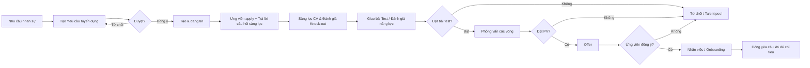
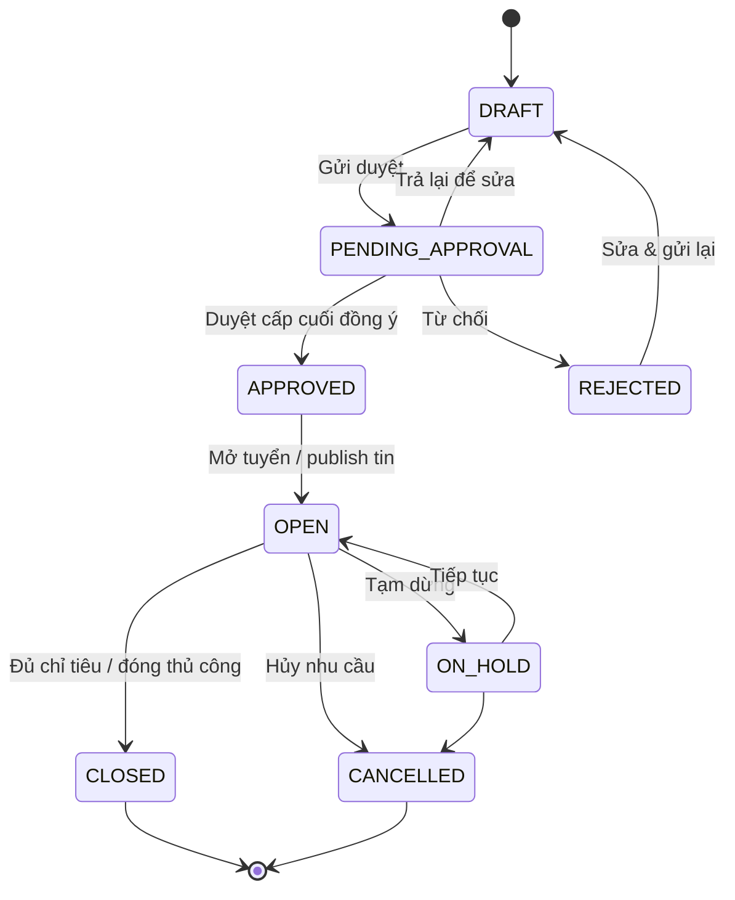
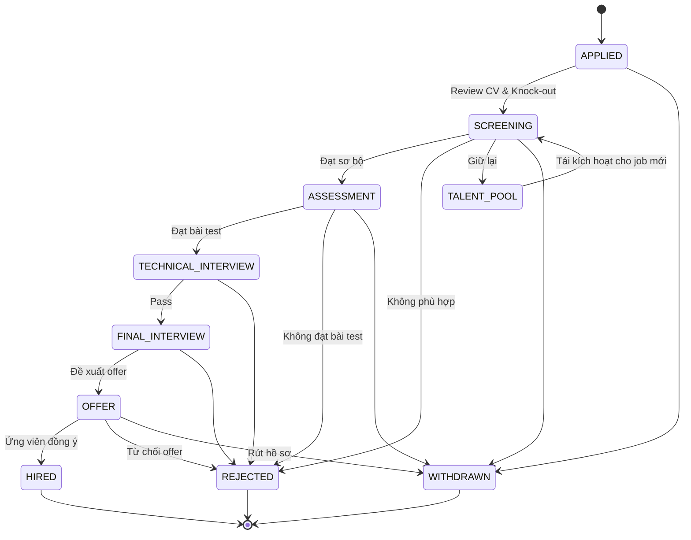
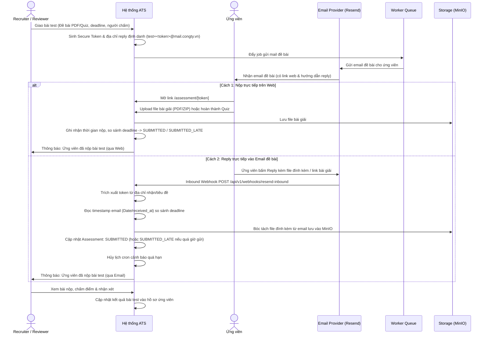
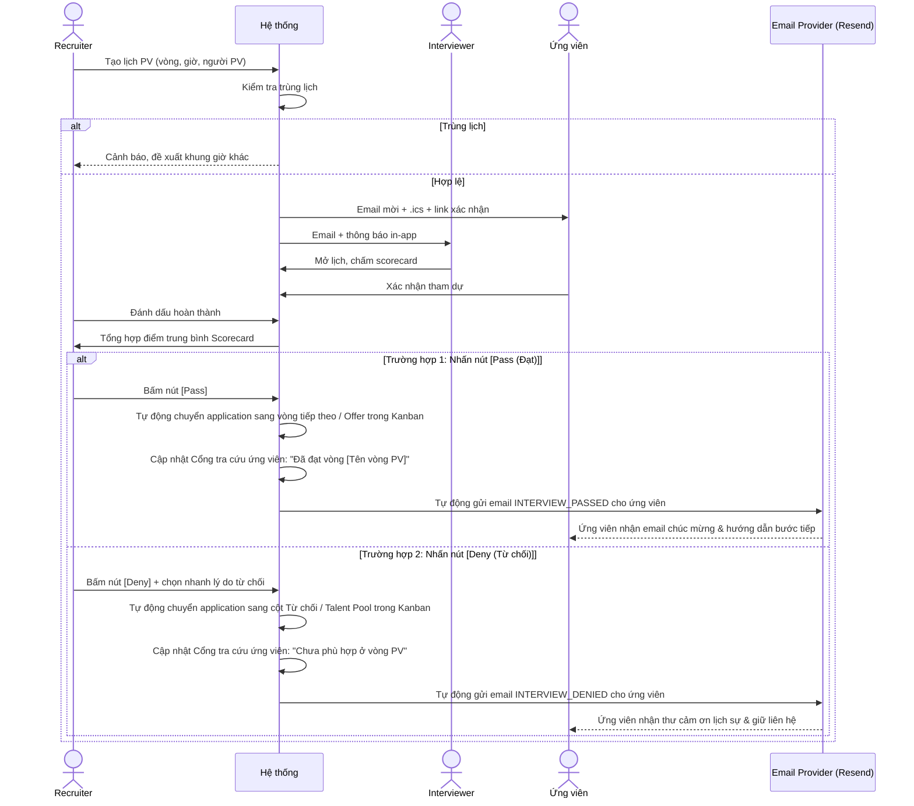
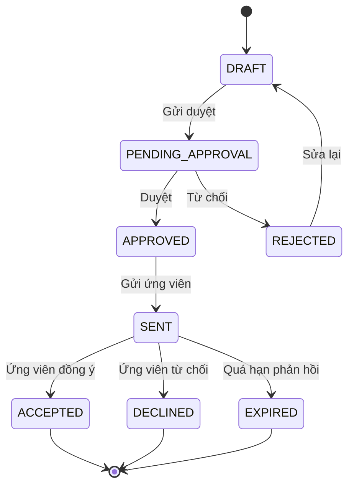
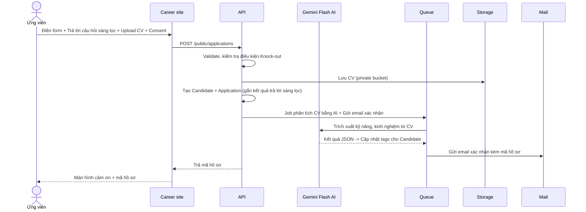
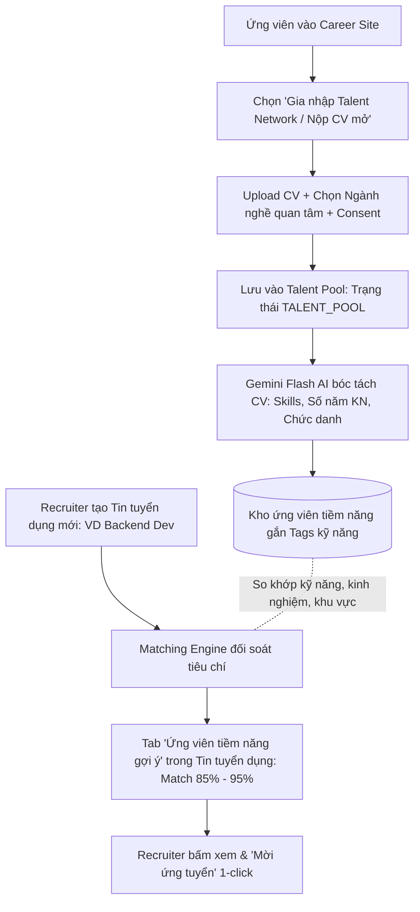

# 02 — Luồng nghiệp vụ & trạng thái

## 1. Luồng tổng quát (end-to-end)

## 2. Trạng thái Yêu cầu tuyển dụng (Requisition)

**Quy tắc**
- Chỉ `APPROVED` hoặc `OPEN` mới được tạo job posting công khai.
- Khi `filledCount >= headcount` → gợi ý đóng; tự đóng nếu bật cấu hình.
- `ON_HOLD` không nhận application mới nhưng vẫn xử lý hồ sơ đang có.

## 3. Trạng thái Application & Pipeline

### 3.1 Cấu hình bước mặc định

| # | Stage | Ai phụ trách | SLA | Điều kiện vào | Điều kiện ra |
|---|---|---|---|---|---|
| 1 | **Ứng tuyển** (Applied) | Recruiter | 1 ngày | Có application mới | Đã review CV & câu hỏi sàng lọc |
| 2 | **Sàng lọc** (Screening) | Recruiter | 2 ngày | CV hợp lệ | Đạt sơ bộ / loại (knock-out) |
| 3 | **Bài test** (Assessment) | Recruiter / Reviewer | 3 ngày | Qua vòng sàng lọc | Có kết quả chấm bài test |
| 4 | **PV chuyên môn** (Technical) | Hiring Manager | 5 ngày | Đạt bài test | Có scorecard |
| 5 | **PV cuối** (Final) | BOD/Manager | 5 ngày | Pass vòng trước | Quyết định offer |
| 6 | **Offer** | HR Manager | 3 ngày | Được duyệt offer | Ứng viên phản hồi |
| 7 | **Nhận việc** (Hired) | HR | — | Offer accepted | Onboarding xong |
| — | **Từ chối** (Rejected) | Bất kỳ | — | Có lý do | Kết thúc |
| — | **Rút hồ sơ** (Withdrawn) | Ứng viên/Recruiter | — | Ứng viên rút | Kết thúc |
| — | **Talent pool** | Recruiter | — | Chưa phù hợp bây giờ | Có thể tái sử dụng |

> Stage có thể cấu hình thêm/bớt trong **Cài đặt → Pipeline**. Mỗi stage có: tên, thứ tự, màu, loại (screening/assessment/interview/offer/hired), yêu cầu lịch PV hay không, SLA (giờ), tiêu chí bắt buộc.

### 3.2 State machine của Application

### 3.3 Quy tắc chuyển bước

- Mọi chuyển bước ghi `ApplicationStageHistory` (from, to, by, at, note).
- Chuyển sang **Từ chối** bắt buộc `rejectReasonId`; lý do "Khác" bắt buộc `note`.
- Chuyển sang stage loại **assessment** → mở modal giao bài test (upload đề hoặc chọn bài test mẫu, set deadline).
- Chuyển sang stage loại **interview** → mở modal tạo lịch PV (có thể bỏ qua nếu đã có lịch).
- Chuyển sang **Offer** → kiểm tra đã có scorecard pass ở vòng cuối; nếu chưa, chỉ HR Manager/Admin được override (ghi log lý do).
- Chuyển sang **Hired** chỉ xảy ra tự động khi offer `ACCEPTED`.
- Khi requisition đóng, application active phải được xử lý hàng loạt: Reject hoặc Talent pool.

## 4. Luồng Giao bài test & Tiếp nhận bài nộp (Web & Inbound Email)

## 5. Luồng đặt lịch, đánh giá & Trả kết quả phỏng vấn 1-click

**Chi tiết & Cơ chế 1-click**
- Một lịch PV có nhiều interviewer; mỗi người một scorecard riêng.
- Scorecard mặc định: Kinh nghiệm chuyên môn, Kỹ năng giải quyết vấn đề, Giao tiếp, Phù hợp văn hóa, Động lực, Tiếng Anh (nếu cần). Thang 1–5 + trọng số + nhận xét.
- **Nút 1-Click Pass / Deny:** Sau khi Scorecard hoàn tất, HR không cần soạn email thủ công:
  - Bấm **Pass**: Hệ thống tự động kích hoạt mẫu email chúc mừng `INTERVIEW_PASSED`, đồng thời cập nhật trạng thái hồ sơ ở cả 2 phía (Kanban và Cổng tra cứu ứng viên).
  - Bấm **Deny**: Popup chọn nhanh lý do từ chối (1 giây), hệ thống tự động kích hoạt mẫu email cảm ơn `INTERVIEW_DENIED` và đồng bộ trạng thái từ chối ở cả 2 phía.
- Huỷ lịch phải nhập lý do; gửi email huỷ cho các bên.

## 6. Luồng Offer & phê duyệt

**Luồng duyệt mặc định**

| Điều kiện | Cấp duyệt |
|---|---|
| Offer trong ngưỡng lương cấu hình | HR Manager |
| Offer vượt ngưỡng | HR Manager → BOD |
| Tuyển vượt headcount | HR Manager → BOD (bắt buộc) |

- Ngưỡng cấu hình tại **Cài đặt → Ngưỡng phê duyệt**.
- Người duyệt thấy: thông tin ứng viên, vị trí, mức lương đề xuất, so sánh với range của requisition, ý kiến người đề xuất.
- Mọi quyết định ghi log + lý do.

## 7. Luồng Onboarding

1. Offer `ACCEPTED` → tự tạo `OnboardingPlan` từ template (theo phòng ban/vị trí).
2. Sinh task: ký hợp đồng, nộp giấy tờ, tạo email/tài khoản, cấp thiết bị, giới thiệu team, đào tạo nội quy.
3. Phân công owner + deadline, theo dõi % hoàn thành.
4. HR đánh dấu hoàn tất → application `HIRED`, cập nhật `filledCount` của requisition.

## 8. Ma trận quyền

Ký hiệu: **F** = toàn quyền, **E** = sửa, **V** = chỉ xem, **O** = chỉ bản ghi của mình, **–** = không.

| Chức năng | Admin | HR Manager | Recruiter | Hiring Mgr | Interviewer | BOD | Employee | Candidate |
|---|---|---|---|---|---|---|---|---|
| Dashboard toàn công ty | F | F | V | V (phòng) | – | V | – | – |
| Requisition | F | F | E (được giao) | E (phòng) | – | V | – | – |
| Duyệt requisition | F | F | – | F (cấp 1) | – | F (cấp 2) | – | – |
| Job posting | F | F | E | V | – | V | – | V (public) |
| Ứng viên / CV | F | F | F | V (phòng) | O | – | – | O (giới hạn) |
| Pipeline | F | F | F | E (phòng) | V (được phân) | V | – | – |
| Bài test (Assessment) | F | F | F | E (phòng) | V / O (chấm) | V | – | O (làm/nộp) |
| Lịch PV | F | F | F | E (phòng) | O | V | – | O (xác nhận) |
| Scorecard | F | V | V | V | O (chấm) | V | – | – |
| Offer | F | F | E (tạo) | V | – | F (duyệt) | – | O (phản hồi) |
| Onboarding | F | F | E | V | – | – | – | – |
| Báo cáo | F | F | V (cá nhân) | V (phòng) | – | F | – | – |
| Cài đặt hệ thống | F | V | – | – | – | – | – | – |
| Audit log | F | V | – | – | – | – | – | – |
| Referral | F | F | F | V | V | – | O (tạo) | – |

> Quyền theo phòng ban áp dụng ở tầng API (row-level filter), không chỉ ẩn ở UI.

## 9. Email & thông báo tự động

| # | Sự kiện | Người nhận | Kênh | Nội dung chính |
|---|---|---|---|---|
| 1 | Requisition gửi duyệt | Người duyệt cấp hiện tại | Email + in-app | Link duyệt, tóm tắt vị trí |
| 2 | Requisition được duyệt/từ chối | Người tạo, Hiring Manager | Email + in-app | Kết quả + ý kiến |
| 3 | Ứng viên apply thành công | Ứng viên | Email | Xác nhận + mã hồ sơ |
| 4 | Có application mới | Recruiter phụ trách | In-app + email daily digest | Danh sách hồ sơ mới |
| 5 | Giao bài test | Ứng viên | Email | Đề bài, hạn nộp, link web + hướng dẫn reply email |
| 6 | Nhắc hạn nộp bài test | Ứng viên | Email | Nhắc trước 24h trước deadline |
| 7 | Ứng viên nộp bài test | Recruiter + Reviewer | Email + in-app | Kèm bài nộp (Web hoặc Email) để chấm |
| 8 | Đặt lịch PV | Ứng viên + interviewer | Email (.ics) + in-app | Thời gian, địa điểm/link |
| 9 | Nhắc lịch PV | Ứng viên + interviewer | Email | Trước 24h và 1h |
| 10 | Đổi/huỷ lịch PV | Các bên liên quan | Email + in-app | Lý do, lịch mới |
| 11 | Bấm Pass phỏng vấn | Ứng viên | Email | Chúc mừng vượt qua vòng PV + hướng dẫn bước tiếp |
| 12 | Bấm Deny phỏng vấn | Ứng viên | Email | Thư cảm ơn đã tham gia PV, thông báo từ chối & giữ liên hệ |
| 13 | Ứng viên bị từ chối ở các bước khác | Ứng viên | Email (tùy chọn bật) | Thư cảm ơn, giữ liên hệ |
| 14 | Offer gửi duyệt | Người duyệt | Email + in-app | Link duyệt |
| 15 | Offer được duyệt | HR tạo offer | In-app | Có thể gửi ứng viên |
| 16 | Offer gửi ứng viên | Ứng viên | Email + PDF | Thư mời, hạn phản hồi |
| 17 | Ứng viên accept/decline | HR + Hiring Manager | Email + in-app | Kết quả |
| 18 | Onboarding task đến hạn | Owner task | Email + in-app | Việc cần làm |
| 19 | SLA quá hạn | Recruiter + quản lý | In-app + email tổng hợp | Danh sách hồ sơ trễ |

**Biến template:** `{{candidate_name}}`, `{{job_title}}`, `{{company_name}}`, `{{interview_time}}`, `{{assessment_deadline}}`, `{{assessment_link}}`, `{{recruiter_name}}`, `{{offer_salary}}`, `{{status_link}}`…

## 10. SLA & escalation

- SLA tính theo **giờ làm việc** (cấu hình 8:00–17:30, T2–T6, trừ ngày lễ).
- Khi quá 80% SLA: nhắc nhẹ (in-app). Quá 100%: đánh dấu đỏ + email cho Recruiter. Quá 150%: báo HR Manager.
- Dashboard có widget "Hồ sơ cần xử lý gấp".
- Báo cáo SLA theo stage, theo recruiter, theo phòng ban.

## 11. Luồng dữ liệu khi ứng viên apply (career site)

## 12. Luồng Kho hồ sơ mở (Talent Network) & AI Matching

