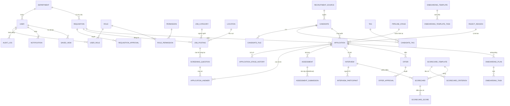

# 04 — Mô hình dữ liệu

## 1. Nguyên tắc thiết kế

- ID: `cuid()` (chuỗi 25 ký tự) cho mọi bảng; không lộ thứ tự bản ghi.
- Mọi bảng có `createdAt`, `updatedAt`; bảng nghiệp vụ chính có `deletedAt` (soft delete).
- Mã hiển thị: `RQ-2026-001`, `CAN-2026-0001`, `APP-2026-0001` — sinh trong transaction, có unique index.
- Tiền tệ lưu dạng `Decimal(15,2)` + `currency` (mặc định VND).
- Thời gian lưu UTC (`timestamptz`), hiển thị theo `Asia/Ho_Chi_Minh`.
- Enum dùng PostgreSQL enum hoặc bảng danh mục (chọn bảng danh mục cho thứ có thể cấu hình: stage, nguồn, lý do từ chối).
- Xóa mềm không áp dụng cho audit log và lịch sử chuyển bước (append-only).

## 2. ERD tổng quan



## 3. Chi tiết bảng

### 3.1 Người dùng & phân quyền

**User**

| Field | Type | Ghi chú |
|---|---|---|
| id | cuid | PK |
| email | varchar(255) | unique, lowercase |
| passwordHash | varchar(255) | Argon2id |
| fullName | varchar(150) | |
| phone | varchar(20) | nullable |
| avatarUrl | text | nullable |
| departmentId | cuid | FK Department, nullable với Admin |
| managerId | cuid | FK User, nullable |
| status | enum | `ACTIVE`, `INACTIVE`, `LOCKED`, `INVITED` |
| lastLoginAt | timestamptz | |
| isSystemAdmin | boolean | bảo vệ không xóa tài khoản cuối |
| createdAt/updatedAt/deletedAt | | |

**Role**: `id`, `code` (unique: ADMIN, HR_MANAGER, RECRUITER, HIRING_MANAGER, INTERVIEWER, BOD, EMPLOYEE), `name`, `description`, `isSystem`.
**Permission**: `id`, `code` (VD `candidate.view`, `offer.approve`), `module`, `action`, `description`.
**RolePermission**: `roleId`, `permissionId` (composite PK).
**UserRole**: `userId`, `roleId`, `scopeDepartmentId` (null = toàn công ty).

### 3.2 Phòng ban, Ngành nghề & Khu vực

**Department**: `id`, `code`, `name`, `parentId` (self FK), `managerId` (FK User), `order`, `isActive`. Hỗ trợ cây bằng `parentId` + `path` (materialized, VD `/it/backend`).

**JobCategory**: `id`, `code` (unique), `name`, `parentId` (self FK - hỗ trợ ngành cha/con), `order`, `isActive`.
**Location**: `id`, `code` (unique), `name` (Tỉnh/Thành phố), `region` (`NORTH`, `CENTRAL`, `SOUTH`, `REMOTE`), `order`, `isActive`.

### 3.3 Yêu cầu tuyển dụng

**Requisition**

| Field | Type | Ghi chú |
|---|---|---|
| id, code | cuid, varchar(20) | `RQ-YYYY-NNN` |
| title | varchar(200) | |
| departmentId | cuid | FK |
| categoryId | cuid | FK JobCategory |
| locationId | cuid | FK Location |
| hiringManagerId | cuid | FK User |
| recruiterId | cuid | FK User (người phụ trách) |
| headcount | int | ≥ 1 |
| filledCount | int | default 0 |
| employmentType | enum | `FULL_TIME`, `PART_TIME`, `CONTRACT`, `INTERNSHIP`, `FREELANCE` |
| workMode | enum | `ONSITE`, `HYBRID`, `REMOTE` |
| salaryMin / salaryMax | Decimal(15,2) | |
| currency | varchar(3) | default VND |
| showSalary | boolean | hiển thị trên tin |
| priority | enum | `LOW`, `NORMAL`, `HIGH`, `URGENT` |
| reason | text | lý do tuyển |
| description / requirements / benefits | text | JD |
| skills | text[] | tag kỹ năng |
| deadline | date | |
| status | enum | `DRAFT`, `PENDING_APPROVAL`, `APPROVED`, `OPEN`, `ON_HOLD`, `CLOSED`, `CANCELLED`, `REJECTED` |
| closeReason | text | |
| createdById | cuid | |
| approvedAt / closedAt | timestamptz | |

**RequisitionApproval**: `id`, `requisitionId`, `level` (1,2,3), `approverId`, `status` (`PENDING`, `APPROVED`, `REJECTED`, `SKIPPED`), `comment`, `decidedAt`. Unique `(requisitionId, level)`.

### 3.4 Tin tuyển dụng & Câu hỏi sàng lọc

**JobPosting**: `id`, `requisitionId`, `title`, `slug` (unique), `categoryId` (FK JobCategory), `locationId` (FK Location), `description`, `requirements`, `benefits`, `employmentType`, `workMode`, `salaryMin`, `salaryMax`, `showSalary`, `deadline`, `status` (`DRAFT`, `PUBLISHED`, `CLOSED`), `publishedAt`, `closedAt`, `viewCount`, `applyCount`, `metaTitle`, `metaDescription`, `coverImageUrl`, `createdById`.

**ScreeningQuestion**: `id`, `jobPostingId` (FK), `type` (`YES_NO`, `SINGLE_CHOICE`, `MULTI_CHOICE`, `TEXT`), `question`, `optionsJson` (danh sách lựa chọn nếu trắc nghiệm), `isKnockout` (boolean), `expectedAnswerJson` (đáp án chuẩn nếu là knock-out), `order` (int), `isRequired` (boolean).

**RecruitmentSource**: `id`, `name`, `type` (`CAREER_SITE`, `JOB_BOARD`, `SOCIAL`, `REFERRAL`, `HEADHUNT`, `OTHER`), `costPerCandidate` Decimal, `isActive`.

### 3.5 Ứng viên & Talent Network

**Candidate**

| Field | Type | Ghi chú |
|---|---|---|
| id, code | cuid, varchar(20) | `CAN-YYYY-NNNN` |
| fullName | varchar(150) | |
| email | varchar(255) | unique (lowercase) |
| phone | varchar(20) | chuẩn hóa +84 |
| dob | date | nullable |
| gender | enum | `MALE`, `FEMALE`, `OTHER` |
| address | text | |
| locationId | cuid | FK Location |
| preferredCategoryId | cuid | FK JobCategory |
| education | varchar(200) | |
| experienceYears | numeric(4,1) | |
| currentCompany / currentTitle | varchar(200) | |
| skills | text[] | tag kỹ năng (AI bóc tách hoặc nhập tay) |
| summary | text | tóm tắt hồ sơ |
| aiParsedSummary | text | tóm tắt tự động bởi Gemini Flash AI |
| avatarUrl | text | |
| sourceId | cuid | FK Source |
| ownerId | cuid | FK User (recruiter phụ trách) |
| consentAt | timestamptz | thời điểm đồng ý xử lý dữ liệu |
| status | enum | `ACTIVE`, `HIRED`, `TALENT_POOL`, `ARCHIVED` |
| lastContactedAt | timestamptz | |

**CandidateFile**: `id`, `candidateId`, `fileName`, `mimeType`, `size`, `storageKey`, `isPrimary`, `uploadedById`, `createdAt`.
**Tag**: `id`, `name` (unique), `color`. **CandidateTag**: `candidateId`, `tagId`.

### 3.6 Pipeline & Application

**PipelineStage**: `id`, `code`, `name`, `order`, `type` (`SCREENING`, `ASSESSMENT`, `INTERVIEW`, `OFFER`, `HIRED`, `REJECTED`, `TALENT_POOL`), `color`, `slaHours`, `requiresSchedule` bool, `isActive`, `isTerminal`.

**Application**

| Field | Type | Ghi chú |
|---|---|---|
| id, code | cuid, varchar(20) | `APP-YYYY-NNNN` |
| candidateId | cuid | FK |
| requisitionId | cuid | FK |
| currentStageId | cuid | FK PipelineStage |
| status | enum | `ACTIVE`, `HIRED`, `REJECTED`, `WITHDRAWN`, `TALENT_POOL` |
| sourceId | cuid | nguồn của lần ứng tuyển |
| ownerId | cuid | recruiter phụ trách |
| isKnockoutFailed | boolean | true nếu trượt câu hỏi knock-out |
| appliedAt | timestamptz | |
| rejectedReasonId | cuid | nullable |
| rejectedNote | text | |
| rejectedAt / hiredAt | timestamptz | |
| stageEnteredAt | timestamptz | dùng tính SLA |

Unique: `(candidateId, requisitionId)` — cho phép cấu hình cho ứng tuyển lại bằng cách tạo bản ghi mới khi bản cũ terminal (dùng unique partial index `WHERE status = 'ACTIVE'`).

**ApplicationAnswer**: `id`, `applicationId` (FK), `questionId` (FK ScreeningQuestion), `answerText` (text), `answerJson` (jsonb), `isKnockoutPassed` (boolean).
**ApplicationStageHistory**: `id`, `applicationId`, `fromStageId`, `toStageId`, `movedById`, `note`, `createdAt`. Append-only.
**RejectReason**: `id`, `group` (`EXPERIENCE`, `SKILL`, `SALARY`, `CULTURE`, `WITHDRAWN`, `OTHER`), `name`, `requiresNote`, `isActive`.

### 3.7 Bài test & Đánh giá năng lực (Assessments)

**Assessment**

| Field | Type | Ghi chú |
|---|---|---|
| id | cuid | PK |
| applicationId | cuid | FK Application |
| candidateId | cuid | FK Candidate |
| title | varchar(255) | Tên bài test / assignment |
| type | enum | `TAKE_HOME`, `ONLINE_QUIZ` |
| instruction | text | Hướng dẫn làm bài |
| attachmentKey | text | Key file đề bài trong MinIO (nếu có) |
| deadline | timestamptz | Hạn chót nộp bài |
| token | varchar(64) | Unique token bảo mật truy cập web test |
| replyToEmail | varchar(100) | Unique địa chỉ reply (test+<token>@...) |
| status | enum | `PENDING`, `SUBMITTED`, `SUBMITTED_LATE`, `GRADED`, `EXPIRED`, `CANCELLED` |
| score | numeric(4,1) | Điểm đánh giá (thang 10 hoặc 100) |
| reviewerId | cuid | FK User (người chấm) |
| feedback | text | Nhận xét chi tiết của người chấm |
| gradedAt | timestamptz | Thời điểm chấm xong |
| createdById | cuid | FK User (người giao) |

**AssessmentSubmission**: `id`, `assessmentId` (FK), `channel` (`WEB`, `EMAIL`), `submittedAt` (timestamptz), `content` (text/link bài giải), `attachmentKeys` (text[] - danh sách file bài nộp trong MinIO), `isLate` (boolean), `emailMessageId` (varchar - đối soát email inbound).

### 3.8 Phỏng vấn & đánh giá

**Interview**: `id`, `applicationId`, `stageId`, `round` (int), `title`, `startAt`, `endAt`, `mode` (`ONSITE`, `ONLINE`, `PHONE`), `location`, `meetingUrl`, `status` (`SCHEDULED`, `CONFIRMED`, `COMPLETED`, `CANCELLED`, `NO_SHOW`), `cancelReason`, `notes`, `createdById`, `result` (`PENDING`, `PASSED`, `DENIED`), `resultDecidedAt`, `resultDecidedById` (FK User), `feedbackSentAt`, `rejectReasonId` (FK RejectReason, nullable).

**InterviewParticipant**: `id`, `interviewId`, `userId`, `role` (`INTERVIEWER`, `OBSERVER`, `COORDINATOR`), `responseStatus` (`PENDING`, `ACCEPTED`, `DECLINED`), `respondedAt`. Unique `(interviewId, userId)`.

**ScorecardTemplate**: `id`, `name`, `stageType`, `isActive`.
**ScorecardCriterion**: `id`, `templateId`, `name`, `description`, `weight` (default 1), `order`, `isRequired`.
**Scorecard**: `id`, `interviewId`, `interviewerId`, `templateId`, `overall` numeric(3,2), `recommendation` (`PASS`, `FAIL`, `HOLD`), `comment`, `submittedAt`, `lockedAt`. Unique `(interviewId, interviewerId)`.
**ScorecardScore**: `id`, `scorecardId`, `criterionId`, `score` (1–5), `comment`.

### 3.9 Offer

**Offer**: `id`, `applicationId`, `candidateId`, `requisitionId`, `title`, `departmentId`, `managerId`, `salary` Decimal, `allowance` Decimal, `bonus` Decimal, `employmentType`, `startDate`, `probationMonths`, `responseDeadline`, `notes`, `status` (`DRAFT`, `PENDING_APPROVAL`, `APPROVED`, `REJECTED`, `SENT`, `ACCEPTED`, `DECLINED`, `EXPIRED`), `createdById`, `approvedAt`, `sentAt`, `respondedAt`, `declineReason`, `offerLetterKey`.

**OfferApproval**: `id`, `offerId`, `level`, `approverId`, `status`, `comment`, `decidedAt`.

### 3.10 Onboarding

**OnboardingPlan**: `id`, `applicationId` (unique), `candidateId`, `startDate`, `status` (`NOT_STARTED`, `IN_PROGRESS`, `COMPLETED`), `progress` (0–100), `createdById`.
**OnboardingTask**: `id`, `planId`, `group`, `title`, `ownerId`, `dueDate`, `status` (`TODO`, `DOING`, `DONE`), `note`, `completedAt`, `order`.
**OnboardingTemplate** / **OnboardingTemplateTask**: mẫu theo phòng ban/loại hợp đồng (`group`, `title`, `ownerRole`, `dueOffsetDays`, `order`).

### 3.11 Hệ thống

**EmailTemplate**: `id`, `code` (unique), `name`, `event`, `subject`, `bodyHtml`, `variables` text[], `isActive`.
**Notification**: `id`, `userId`, `type`, `title`, `body`, `link`, `isRead`, `createdAt`. Index `(userId, isRead, createdAt)`.
**NotificationRule**: `id`, `event`, `channel` (`IN_APP`, `EMAIL`), `recipientRole`, `isActive`.
**Setting**: `id`, `key` (unique), `valueJson` — ngưỡng duyệt, cấu hình SLA, thông tin công ty, bật/tắt tính năng.
**SavedView**: `id`, `userId`, `module`, `name`, `filtersJson`, `isShared`.
**AuditLog**: `id`, `userId`, `action` (`CREATE`, `UPDATE`, `DELETE`, `APPROVE`, `REJECT`, `LOGIN`, `EXPORT`, `DOWNLOAD_FILE`), `entityType`, `entityId`, `before` jsonb, `after` jsonb, `ip`, `userAgent`, `requestId`, `createdAt`. Index `(entityType, entityId)`, `(createdAt)`, `(userId)`.

## 4. Enum tổng hợp

```ts
enum RequisitionStatus { DRAFT PENDING_APPROVAL APPROVED OPEN ON_HOLD CLOSED CANCELLED REJECTED }
enum Priority { LOW NORMAL HIGH URGENT }
enum EmploymentType { FULL_TIME PART_TIME CONTRACT INTERNSHIP FREELANCE }
enum WorkMode { ONSITE HYBRID REMOTE }
enum ApplicationStatus { ACTIVE HIRED REJECTED WITHDRAWN TALENT_POOL }
enum AssessmentType { TAKE_HOME ONLINE_QUIZ }
enum AssessmentStatus { PENDING SUBMITTED SUBMITTED_LATE GRADED EXPIRED CANCELLED }
enum QuestionType { YES_NO SINGLE_CHOICE MULTI_CHOICE TEXT }
enum SubmissionChannel { WEB EMAIL }
enum InterviewStatus { SCHEDULED CONFIRMED COMPLETED CANCELLED NO_SHOW }
enum InterviewResult { PENDING PASSED DENIED }
enum OfferStatus { DRAFT PENDING_APPROVAL APPROVED REJECTED SENT ACCEPTED DECLINED EXPIRED }
enum ApprovalStatus { PENDING APPROVED REJECTED SKIPPED }
enum UserStatus { ACTIVE INACTIVE LOCKED INVITED }
enum OnboardingStatus { NOT_STARTED IN_PROGRESS COMPLETED }
enum TaskStatus { TODO DOING DONE }
```

## 5. Index & ràng buộc quan trọng

| Bảng | Index / Constraint |
|---|---|
| Candidate | unique `lower(email)`; index `phone`; GIN `skills`; GIN full-text `fullName + summary`; index `ownerId`, `sourceId`, `status`, `(locationId, preferredCategoryId)` |
| Application | unique partial `(candidateId, requisitionId) WHERE status='ACTIVE'`; index `(requisitionId, currentStageId, status)`; index `ownerId` |
| ApplicationAnswer | index `(applicationId, questionId)` |
| ScreeningQuestion | index `(jobPostingId, order)` |
| Assessment | unique `token`; unique `replyToEmail`; index `(applicationId, status)`; index `(deadline, status)` |
| AssessmentSubmission | index `assessmentId`; index `emailMessageId` |
| ApplicationStageHistory | index `(applicationId, createdAt desc)` |
| Interview | index `(startAt)`, `(applicationId)`; check `endAt > startAt` |
| InterviewParticipant | unique `(interviewId, userId)`; index `userId` |
| Scorecard | unique `(interviewId, interviewerId)` |
| Offer | index `status`, `(requisitionId)`; check `salary > 0` |
| Requisition | unique `code`; index `(status, departmentId, categoryId, locationId)`; check `headcount >= 1`, `salaryMax >= salaryMin` |
| JobPosting | unique `slug`; index `status`; Composite index `idx_jobs_filter (locationId, categoryId, status)` |
| JobCategory | unique `code`; index `parentId` |
| Location | unique `code`; index `region` |
| AuditLog | index `(entityType, entityId)`, `(createdAt desc)` |
| Notification | index `(userId, isRead, createdAt desc)` |
| Department | unique `code`; index `parentId` |

## 6. Dữ liệu mẫu (seed)

- **Phòng ban:** Ban Giám đốc, Nhân sự, IT (Backend, Frontend, QA), Kinh doanh, Marketing, Kế toán.
- **Vai trò:** 7 vai trò hệ thống + ma trận quyền đầy đủ.
- **Người dùng demo:** admin@congty.vn, hr@congty.vn, recruiter@congty.vn, manager@congty.vn, interviewer@congty.vn, bod@congty.vn (mật khẩu `Demo@12345`).
- **Nguồn:** Career site, TopCV, LinkedIn, Facebook, Referral, Headhunt.
- **Stage:** 7 bước mặc định + Từ chối + Talent pool.
- **Lý do từ chối:** 8–10 lý do theo nhóm.
- **Mẫu email:** 10 template tương ứng bảng trigger ở `02-workflows.md §8`.
- **Scorecard template:** HR Screening, Technical Interview, Final Interview.
- **Dữ liệu nghiệp vụ:** 5 requisition ở các trạng thái khác nhau, 4 job posting, 40 ứng viên, 55 application trải đều các bước, 12 interview (quá khứ + tương lai), 8 scorecard, 4 offer (đủ trạng thái), 3 onboarding plan.
- **Audit log:** sinh tự động theo thao tác seed.

> Seed dùng để demo/UAT; có script `db:seed` riêng và `db:reset` cho môi trường dev.
